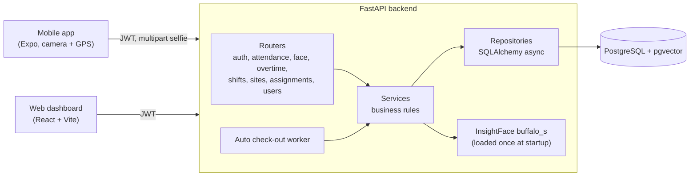

# HadirOps

Attendance and workforce operations for field and plant employees. Employees check in from a mobile app with face verification and GPS; supervisors and admins manage sites, shifts, assignments and overtime approvals from a web dashboard.

The system has three parts that share one API:

| Component | Stack | Used by |
| --- | --- | --- |
| [`backend/`](backend/) | FastAPI, SQLAlchemy (async), PostgreSQL with `pgvector`, InsightFace | Mobile app and web dashboard |
| [`web/`](web/) | React, Vite, TypeScript, Tailwind CSS, TanStack Query and Table, Leaflet | Admins and supervisors |
| [`mobile/`](mobile/) | React Native with Expo SDK 54, TypeScript | Employees and supervisors |

## Screenshots

Web dashboard and mobile app with fictional sample data.

| Dashboard | Attendance monitoring |
| --- | --- |
|  |  |
| **User management** | **Admin login** |
|  |  |


## What it does

- Check-in and check-out with a selfie. The backend detects exactly one face, extracts a 512-dimension InsightFace embedding and compares it with the enrolled embedding by cosine similarity against a configurable threshold.
- Location check per site. The distance to the site is computed with the Haversine formula; a check-in outside the radius is recorded as `OUT_OF_RADIUS` instead of being silently rejected, so supervisors can review it.
- Shift matching and lateness. Each site has its own timezone. Timestamps are stored in UTC and business rules (today's shift, `ONTIME` or `LATE` with tolerance) run in site-local time.
- Automatic check-out. A background worker started with the API closes open attendance records after their shift ends.
- Overtime. Weekend and holiday work is counted as overtime at check-out. Weekday overtime goes through a request and approval flow, and only one pending or approved request is allowed per attendance record.
- Assignments, holidays, sites with a map picker, reports and exports in the web dashboard.
- Role-based access for `ADMIN`, `SUPERVISOR` and `EMPLOYEE`. Supervisors only see and approve their direct reports; employees only see their own records.

## Architecture



The web admin and mobile app share one design system with IEMS ([design-system/hadirops/MASTER.md](design-system/hadirops/MASTER.md)): navy chrome, soft-depth cards, one blue action color, Plus Jakarta Sans bundled with the web build, and color tokens instead of hex values in the mobile screens.

The backend follows a router, service and repository split. The InsightFace model is loaded once in the FastAPI lifespan hook and injected into the face service, so requests do not pay the model load cost. Rate limiting uses `slowapi`.

### Check-in flow

A check-in is accepted only after the face matches the stored embedding. The server then applies the location and shift rules and stores the result.

<picture>
  <source media="(prefers-color-scheme: dark)" srcset="https://raw.githubusercontent.com/Javanian/Hadir-Ops/main/docs/diagrams/hadirops-checkin-dark.svg">
  
</picture>

Generated from [docs/diagrams/hadirops-checkin.json](docs/diagrams/hadirops-checkin.json); the [interactive version](docs/diagrams/hadirops-checkin.html) lists the source lines behind each step.

## Run locally

Requirements: Docker Desktop with at least 4 GB of memory, Node.js 18 or newer, and Expo Go on a phone on the same network as your computer.

```bash
# 1. Environment files (defaults work for local development)
cp .env.example .env
cp backend/.env.example backend/.env

# 2. Backend, database and web dashboard
docker compose up -d --build
docker compose logs -f backend   # wait until the face model has loaded

# 3. Sample data: sites, shifts, supervisor/employee hierarchy, attendance
docker compose exec backend python seed.py

# 4. Mobile app
cd mobile
npm install
npm start -- --clear             # scan the QR code with Expo Go
```

On Windows PowerShell, use `Copy-Item` instead of `cp` for step 1.

| Service | URL |
| --- | --- |
| Web dashboard | http://localhost:5173 |
| API | http://localhost:8000 |
| Swagger UI | http://localhost:8000/docs |
| ReDoc | http://localhost:8000/redoc |

### Seed accounts (local only)

| Role | Email | Password |
| --- | --- | --- |
| Admin | `admin@presensiv2.local` | `Admin@123` |
| Supervisor | `spv101@example.com` | `12345` |
| Employee | `emp101@example.com` | `12345` |

These accounts exist only after running `seed.py`. Do not use them in any shared or production deployment.

### Useful commands

```bash
docker compose restart backend   # restart the API
docker compose down              # stop, keep database data
docker compose down -v           # stop and delete the database volume
```

## Repository notes

- Source, SQL migrations, app assets, npm lockfiles and `.env.example` are tracked. Local environment files, agent and MCP configuration, dependencies, build output and runtime data are not.
- The project started under the working name `presensiv2`, which is still used for container names, native package identifiers and the seed admin account. The database and schema are named `hadirops`.
- The user interface is in Indonesian.

## Limitations

- There is no automated test suite or CI workflow yet.
- Face verification compares embeddings only. It has no liveness or anti-spoofing check, so a printed photo of an enrolled employee may pass.
- InsightFace runs on CPU inside the backend container, which makes the first start slow.

## Author

Tee San ([Javanian](https://github.com/Javanian)) · [Portfolio](https://porto.hillteo.com) · [teesanfajar@gmail.com](mailto:teesanfajar@gmail.com)
